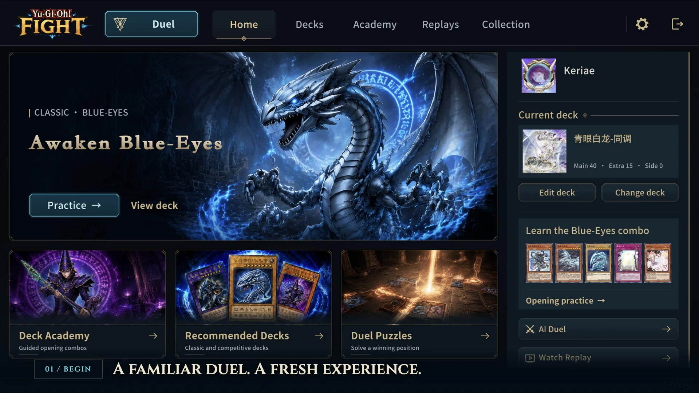

<div align="center">

# Yu-Gi-Oh! Fight

**Build your deck. Learn your opening. Challenge an AI duelist.**

An unofficial, non-commercial desktop dueling client with a cohesive interface, guided practice, customizable AI duelists, and real duel replays.

[English](#play-your-way) · [简体中文](#中文) · [Build from source](docs/BUILDING.md) · [Copyright & credits](THIRD_PARTY_NOTICES.md)

</div>

[](docs/media/launch-trailer-en.mp4)

**[English trailer](docs/media/launch-trailer-en.mp4)** · **[中文宣传片](docs/media/launch-trailer-zh.mp4)** · **[Watch a complete recorded duel](docs/media/full-duel.mp4)**

## Play your way

- **Make a deck your own.** Browse classic and competitive builds, organize your collection, search the card pool, inspect card text, and edit your Main, Extra, and Side Decks.
- **Learn by playing.** Explore 52 academy decks with opening-hand exercises, step-by-step combo guides, authentic demonstration replays, and puzzle challenges.
- **Meet your AI duelists.** Create separate profiles with their own model, endpoint, credentials, and appearance. Play against an AI, watch two AI profiles duel, or practice against the local computer opponents.
- **Keep the duel in focus.** Read the duel log, inspect attached effects, adjust sound and presentation, and view your deck through the same dark-blue, gold, and cyan interface. The duel screen stays free of the chat window.
- **Replay and review.** Watch saved duels with pause, speed controls, card inspection, and the available replay perspectives.
- **Personalize the experience.** Choose avatars, frames, sleeves, fields, mates, characters, and voice settings. Interface and card languages can be selected separately.

AI duels use a user-configured Responses-compatible service and may incur that provider's usage charges. Local computer opponents and academy exercises do not require an AI API key.

## Get started

The current distribution target is **macOS 13 or later**. The packaged app includes its runtime; players do not need Unity Editor or .NET.

Download the macOS installer from [GitHub Releases](https://github.com/keriae/Yu-Gi-Oh-Fight/releases). See [the installation guide](docs/BUILDING.md#optional-macos-packages) for split downloads and first-launch instructions.

For a source build on macOS, install **Python 3.12+**, a **Swift 6+ compiler** (such as Xcode 16+ Command Line Tools), and **zstd** (`brew install zstd` if using Homebrew). Make sure `python3` and `xcrun swiftc --version` select those versions, then run:

```sh
python3 prepare-dependencies.py
python3 build.py --open
```

The app is generated at `dist/Yu-Gi-Oh! Fight.app`. Dependency downloads are pinned and verified. If preparation is interrupted, rerun the same command to resume; existing files are verified and missing or damaged files are repaired. See [the build guide](docs/BUILDING.md) for reusing an existing runtime, code updates, and optional archives. Other platforms are not validated by this project.

Your decks, replays, settings, and remembered AI credentials live in `~/Library/Application Support/Yu-Gi-Oh! Fight/`. They are separate from the repository and the app bundle. To preview importing an older MDPro3 Offline save, run `python3 scripts/import-legacy-state.py`; add `--apply` to copy missing files while preserving existing saves. Credentials are excluded from imports unless explicitly requested.

## Languages

The redesigned client includes English, Simplified Chinese, and Traditional Chinese text, including academy material. The upstream runtime provides ten standard locales for its interface and card data. Other locales use upstream translations where available and English for new client text. First launch follows the system language when supported; saved language choices are preserved. Card availability and translation coverage depend on the installed upstream language resources.

## Source and credits

The client builds on **MDPro3** and its matching duel engine and runtime. This repository contains the editable client sources, independent UI artwork, academy content, a macOS launcher, and reproducible build tooling. Large runtime downloads, build products, personal data, and local acceptance scripts are excluded from Git.

| Location | Contents |
| --- | --- |
| `game/Assets/Scripts/MDPro3/` | Client and duel integration |
| `content/client-ui/` | Artwork and client translations |
| `content/deck-academy/` | Decks, exercises, guides, and replay data |
| `Sources/`, `native/` | macOS launcher and native bridges |
| `scripts/`, `tools/` | Build, resource, and release verification tools |
| `docs/` | Build notes, asset provenance, and gameplay media |

**An unofficial, non-commercial fan project by [keriae](https://github.com/keriae), for personal learning, research, and community exchange.** Please do not use original project content for commercial sale, paid redistribution, or commercial operation unless its separate license permits that use.

The project is not affiliated with or endorsed by Konami. Yu-Gi-Oh! names, cards, characters, and game assets belong to their respective rights holders. Upstream code, third-party components, fonts, and separately licensed contributions retain their applicable terms. Public source availability does not give the whole repository a single open-source license or grant rights in game assets. The matching [MDPro3 README](https://code.moenext.com/mycard/MDPro3/-/blob/72fb92ad02d173aeb5a5bb06f23603d892aec9c1/README.md) documents its development and resource sources; this project's non-commercial purpose does not change those sources' terms. See [COPYRIGHT.md](COPYRIGHT.md), [THIRD_PARTY_NOTICES.md](THIRD_PARTY_NOTICES.md), and [asset provenance](docs/ASSETS.md).

---

## 中文

**构筑自己的卡组，练习起手展开，与 AI 决斗者对战。**

Yu-Gi-Oh! Fight 是基于 MDPro3 的非官方、非商业桌面决斗客户端。首页、卡组、学院、回放、收藏、设置以及对战菜单统一采用暗蓝、古金与青蓝视觉，保留真实卡图、原生规则和对战演出。

[观看中文宣传视频](docs/media/launch-trailer-zh.mp4) · [观看英文宣传视频](docs/media/launch-trailer-en.mp4) · [观看完整对战录屏](docs/media/full-duel.mp4)

### 主要功能

- **卡组构筑**：浏览经典与竞技推荐，管理分组，搜索卡池，阅读卡文，编辑主卡组、额外卡组和副卡组。
- **学习与练习**：52 套学院卡组，固定起手练习、逐步展开指导、真实示范录像与残局挑战。
- **AI 分身对战**：为不同分身单独配置模型、服务、密钥和外观；支持玩家对 AI、AI 对 AI 观战及本地电脑对战。
- **精细对战菜单**：日志、附加效果、设置、卡组查看和相关弹窗融入现有界面；对战时移除聊天窗口。
- **录像复盘**：暂停、加速、查看卡片，以及录像支持的不同观看视角。
- **外观与多语言**：头像、头像框、卡套、场地、伙伴、角色与语音设置；界面语言和卡片语言分别选择。

AI 对战需要自行配置兼容 Responses 的服务，费用由对应服务收取。本地电脑对战和学院练习不需要 AI 密钥。

### 构建与存档

应用运行支持 **macOS 13+**，安装包自带运行时，运行无需 Unity Editor 或 .NET。可从 [GitHub Releases](https://github.com/keriae/Yu-Gi-Oh-Fight/releases) 下载安装包，分卷合并和首次打开说明见[安装指南](docs/BUILDING.md#optional-macos-packages)。

在 macOS 上构建源码需要 **Python 3.12+**、**Swift 6+ 编译器**（例如 Xcode 16+ Command Line Tools）与 **zstd**（使用 Homebrew 时可运行 `brew install zstd`）。确认 `python3` 和 `xcrun swiftc --version` 指向所需版本，再执行：

```sh
python3 prepare-dependencies.py
python3 build.py --open
```

输出为 `dist/Yu-Gi-Oh! Fight.app`。准备过程中断后，重新执行相同命令即可续传；已有文件会经过校验，缺失或损坏的文件会自动修复。完整步骤、依赖复用与更新说明见[构建文档](docs/BUILDING.md)。本项目尚未验证其他平台。

运行数据保存在 `~/Library/Application Support/Yu-Gi-Oh! Fight/`，不会进入仓库或安装包。旧版存档可用 `python3 scripts/import-legacy-state.py` 预览导入；加 `--apply` 仅复制缺失文件，保留现有数据，默认不导入密钥。

新版页面和学院材料提供英文、简体中文与繁体中文；上游界面与卡片数据提供十种标准语言，其他语言的新页面文案回退到英文。首次启动按受支持的系统语言选择，保留已有用户的设置；具体卡片翻译取决于安装的上游语言资源。

### 版权与来源

**本项目由 [keriae](https://github.com/keriae) 维护，是面向个人学习、研究与社区交流的非官方、非商业爱好者项目。** 除另有独立许可明确允许外，请勿将本项目原创内容用于商业销售、付费分发或商业运营。

本项目与科乐美（Konami）无关联，也未获其背书。游戏王名称、卡片、角色及游戏素材归各自权利人所有；上游代码、第三方组件、字体与另有独立许可的贡献仍适用各自条款。源码公开不等于整个仓库获得统一开源授权，也不构成游戏资源授权。对应版本的 [MDPro3 README](https://code.moenext.com/mycard/MDPro3/-/blob/72fb92ad02d173aeb5a5bb06f23603d892aec9c1/README.md) 说明了开发与资源来源，本项目的非商业定位不改变这些来源的许可。具体范围见 [COPYRIGHT.md](COPYRIGHT.md)、[第三方说明](THIRD_PARTY_NOTICES.md) 和[素材来源](docs/ASSETS.md)。
