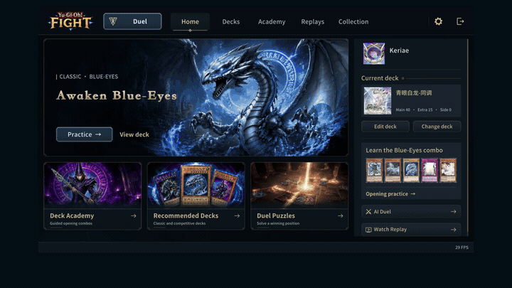
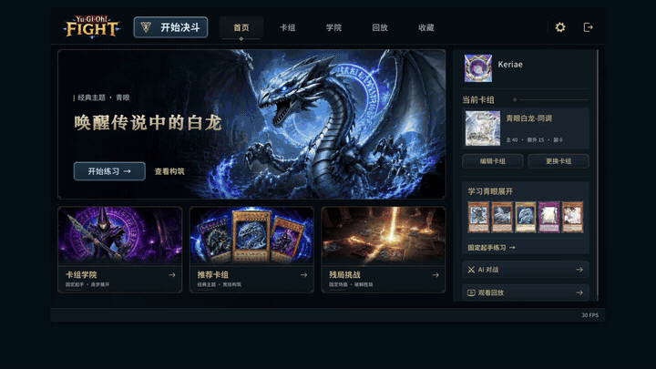

# Yu-Gi-Oh! Fight

**Full card pool. Build your deck. Duel the AI.**

**[Download for macOS 13+](https://github.com/keriae/Yu-Gi-Oh-Fight/releases)**

[Trailer](docs/media/launch-trailer-en.mp4) · [Full duel](docs/media/full-duel.mp4)

- **Full card pool.** Find your favorites and build your Main, Extra, and Side Decks.
- **AI duels.** Challenge an AI, watch AI vs AI, or play local computer opponents.
- **52 academy decks.** Master your openings with guided practice, combo guides, and puzzles.
- **Read the duel. Make your next move count.** Inspect cards and duel logs, then review your replays.
- **Your style, your language.** Customize avatars, sleeves, fields, and voices; choose interface and card languages separately.

Unofficial, noncommercial fan project, unaffiliated with Konami. Game names, cards, and assets belong to their owners; applicable third-party licenses are retained. [Notices](THIRD_PARTY_NOTICES.md).

---

## 中文

**全卡池自由构筑，与 AI 决斗者对战。**

**[下载 macOS 13+ 版](https://github.com/keriae/Yu-Gi-Oh-Fight/releases)**

[宣传片](docs/media/launch-trailer-zh.mp4) · [对战录屏](docs/media/full-duel.mp4)

- **全卡池构筑**：主卡组、额外卡组、副卡组，自由搭配。
- **AI 对战**：挑战 AI、观看 AI 对决，也可挑战本地电脑。
- **52 套学院卡组**：起手练习、展开指南、残局挑战。
- **读懂战局，决胜下一手**：查看卡片与日志，回放复盘。
- **打造你的风格**：头像、卡套、场地、语音，界面与卡片语言自由选择。

非官方、非商业爱好者项目，与科乐美无关联。游戏名称、卡片及素材归各自权利人所有，第三方内容遵循各自许可。[版权说明](THIRD_PARTY_NOTICES.md)。

